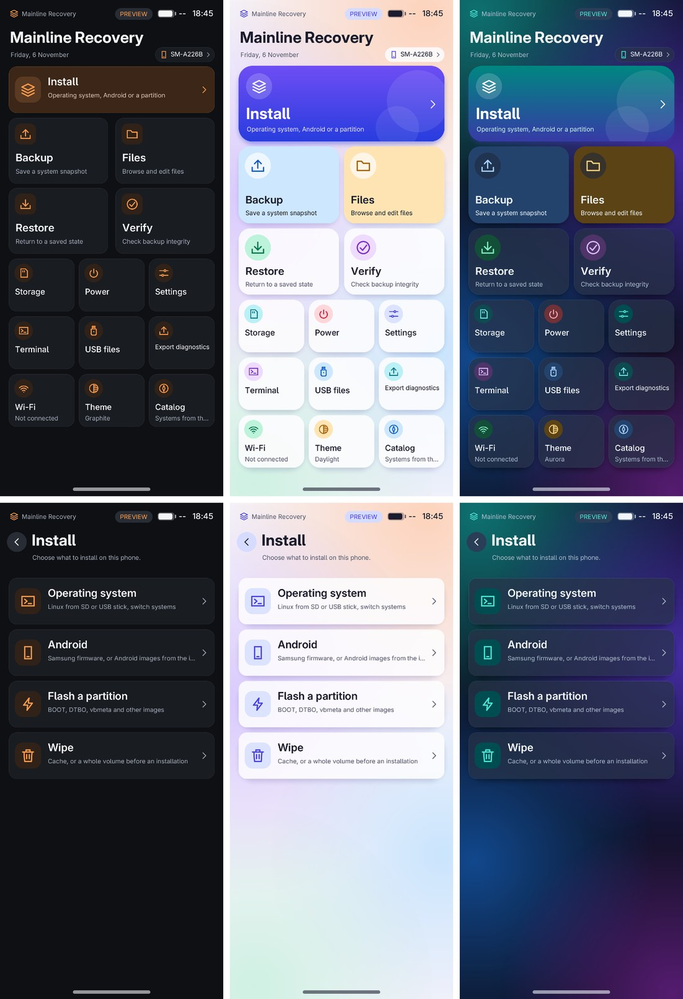
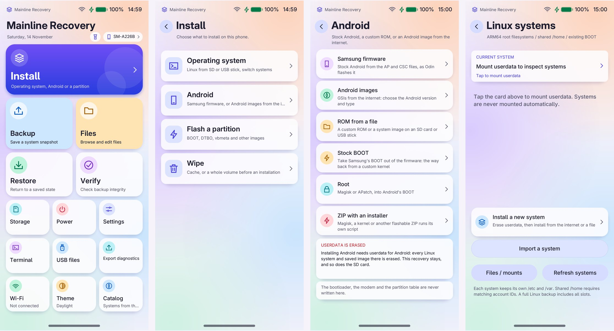
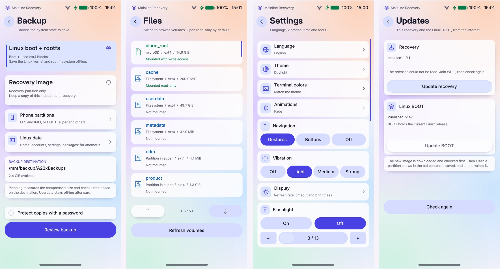
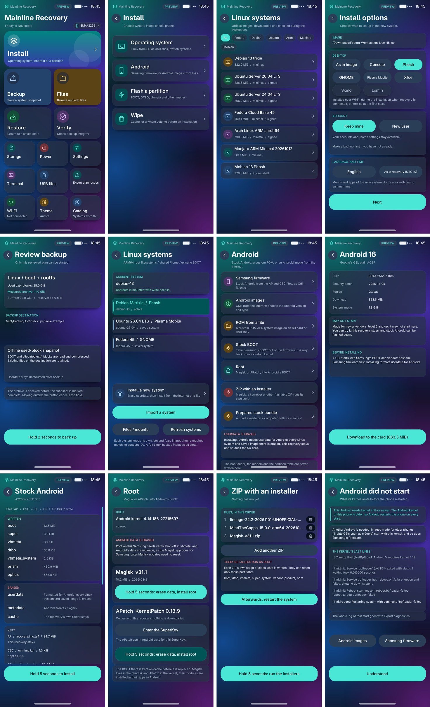
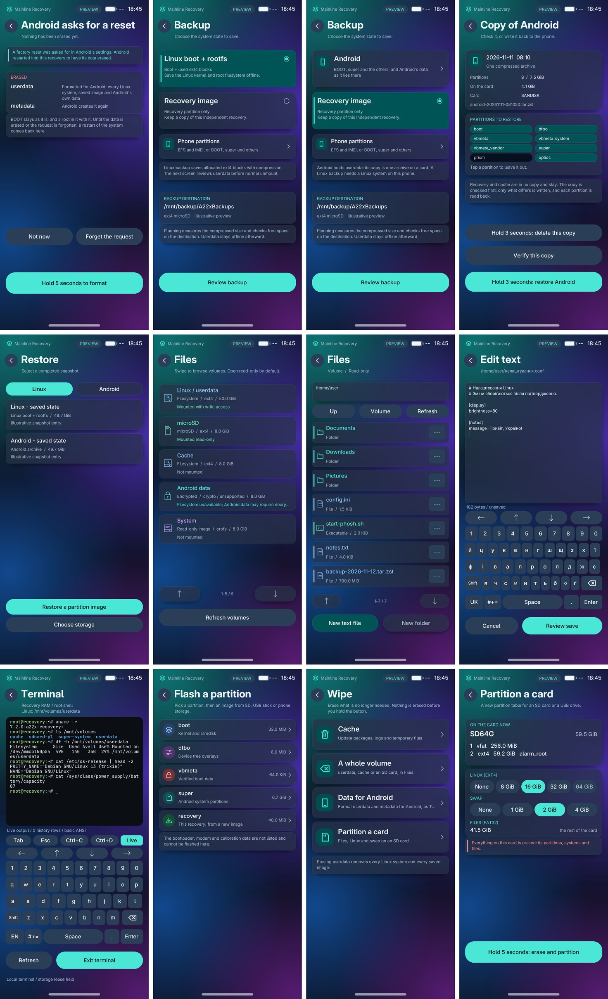
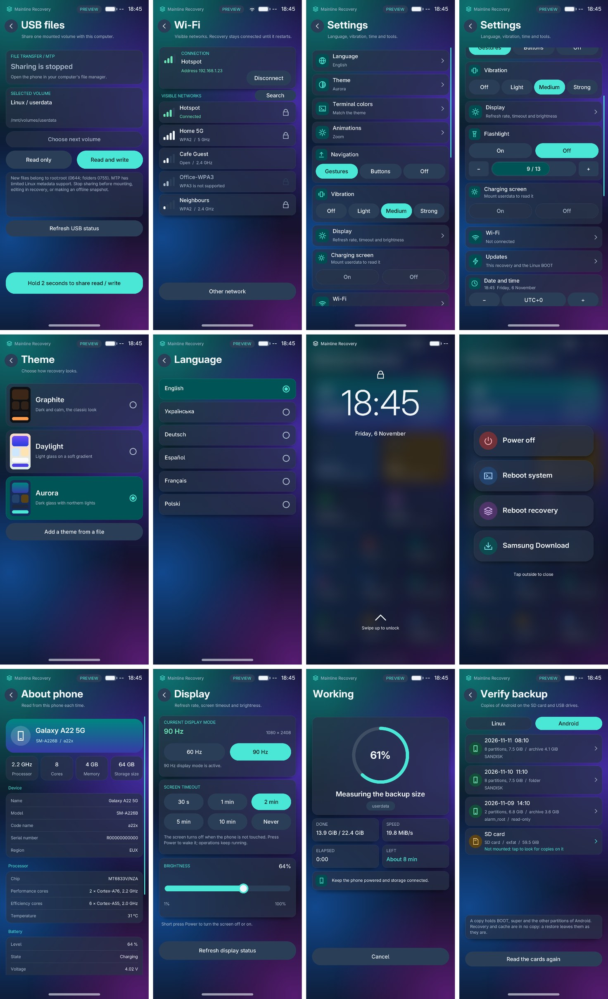

# Mainline Recovery

A native Linux recovery for the **Samsung Galaxy A22 5G (SM-A226B, MT6833)**.
It lives in the 40 MiB RECOVERY partition, runs entirely from RAM and has its own
touch interface. It installs and manages Linux distributions, installs Android
(Samsung's firmware, GSIs and ROMs), flashes partitions, makes backups, and does
the everyday work of a TWRP-style recovery.

Ukrainian: [README.uk.md](README.uk.md) · What changed in each version:
[CHANGELOG.md](CHANGELOG.md) · Test results: [docs/TEST_RESULTS.md](docs/TEST_RESULTS.md)

| | |
|---|---|
| Download | [Releases](https://github.com/Dodaskot/mainline-recovery/releases): the recovery image and the installer app |
| Phone | SM-A226B only, 64 GB and 128 GB (tested on a 64 GB phone). Images and firmware are checked to be made for it |
| Recovery kernel | `7.2.0-a22x-recovery+`, [linux-a22x](https://github.com/Dodaskot/linux-a22x) branch `a22x-recovery`: the phone's kernel (branch `a22x`) trimmed for the recovery |
| Linux BOOT | the mainline kernel of [a22x-mainline](https://gitlab.com/pessdres/a22x-mainline), downloaded by the recovery when a system needs it |

## Screenshots

Rendered by the interface itself from its preview data. The three built-in
themes, Graphite, Daylight and Aurora:



Taken on the phone with 1.0.1 (the screenshot keys, Power + Volume down):




More, from the preview data:





More, page by page: [docs/screenshots/en](docs/screenshots/en).

## Features

### Linux systems

- **Install** a distribution from the built-in **catalog** over Wi-Fi: Debian 13,
  Ubuntu 24.04 and 26.04, Fedora 45, Arch Linux ARM, Manjaro ARM and Mobian 13.
  Every image is checked against its published checksum and signature.
- **From a file** on microSD, a USB stick or the phone: rootfs `tar`, disk images
  (`.img`, `.img.xz`) and `qcow2`; postmarketOS images for other phones work too.
- Choose for each installation: desktops (Phosh, GNOME, Plasma Mobile, Xfce, Sxmo,
  Lomiri), the sign-in screen (automatic, text, Phrog, GDM, SDDM, LightDM),
  language and time zone, the user account, apps and packages, Wi-Fi and a setup
  script. Desktops are installed with their packages by the recovery itself;
  phoc gets this phone's fix built on the phone.
- **Several systems side by side** on `userdata` with a shared `/home`: switch
  between them, roll a switch back, remove one, or keep images on the phone to
  install later without a network.
- The recovery adds the kernel modules, firmware and device services each system
  needs, and puts the right Linux BOOT in place by itself.
- One battery percent shared by the recovery and the installed systems.

### Android

- **Samsung firmware** (`AP_….tar.md5` with CSC, BL, CP beside it, or the whole
  firmware ZIP as downloaded), as Odin flashes it, without the bootloader chain,
  the modem or the PIT; then data is formatted for Android as stock recovery does.
- **GSIs and ROMs**: from the catalog (Google's GSIs, LineageOS, crDroid and others),
  or from a file: a system image, a 7z, a block-based OTA, `payload.bin`, an image
  ZIP or a flashable ZIP.
- **Flashable ZIPs** with their own installer (`update-binary`, edify), one or
  several in a row, each in an isolated room that sees only the partitions an
  Android ROM may change; `adb sideload` works as in TWRP. Tested on the phone:
  LineageOS 20 for the A226B (by Loftenth), AnyKernel3 kernels, Magisk; BakaSU (by
  Kazaf 132) also started. A block-based ROM whose
  own installer fails is written by the recovery itself, and super is laid out for
  a ROM whose partitions do not fit.
- After a ZIP changed Android's BOOT, the recovery offers to reset Android's data:
  on this Samsung, Android does not start on its old data with a changed BOOT.
- **Root**: Magisk (the newest release, patched on the phone) or APatch; root can
  be removed again.
- **Why Android did not start**: the recovery reads the last kernel log Android left
  in memory and explains it (for example an Android that needs a newer kernel).
- **Factory reset** asked for in Android's settings is carried out here.

### Backup and restore

- **Copies of Android's partitions** as one compressed
  archive (`tar.zst`) on a card or USB drive, optionally with Android's encrypted
  data. A restore checks the archive first and writes only what differs.
- **Linux snapshots**: BOOT and the used blocks of `userdata` (partclone, zstd),
  verified before they are marked complete; restore and wipe of `userdata` from a
  snapshot, on any SM-A226B with the same layout.
- **Linux data**: home folders, accounts, settings (Wi-Fi, Bluetooth, SSH, locale)
  and the list of packages, without the system, into one archive. It is restored
  into another distribution installed here, or on any other Linux device with the
  `restore.sh` inside it: packages are installed under the names that system uses.
- **Copies of EFS and IMEI** (the phone's identity partitions).
- **Protected with a password** (Backup > "Protect copies with a password"): copies
  of Android, Linux data and archives made in Files are encrypted (AES-256-CTR,
  PBKDF2-SHA-256, an HMAC over the whole file). They open on any computer with
  `openssl`, without the recovery:

  ```fish
  head -c -56 NAME.tar.zst.enc | openssl enc -d -aes-256-ctr -pbkdf2 -iter 600000 -md sha256 | tar --zstd -x
  ```

  Linux snapshots, the recovery image and EFS/IMEI copies are saved without it.
- Backups can be verified, renamed and deleted on the phone.

### Flashing

- **Flash a partition**: BOOT, recovery, DTBO, vbmeta, super, prism, optics, or one
  partition inside super (`system`, `vendor`, `product`, `odm`), from raw, sparse,
  gzip, LZ4, XZ or ZSTD images, also straight from a ZIP or a Samsung tar.
- An image is judged by its **contents**: a BOOT or recovery image must be complete
  and name this phone; an image for another phone is refused before anything is
  written. The bootloader, preloader, LK and modem are never written.
- The old content is saved first and the partition is read back. A write that
  fails puts the saved copy back at once; a write cut short by a power loss is
  finished or undone at the next start of the recovery.
- **Updates** in Settings: the newest published recovery and Linux BOOT are checked,
  downloaded and written the same safe way.
- Cache tidies itself: older copies of recovery and BOOT go; the stock BOOT, the newest
  copies and the settings stay.

### Files and storage

- File manager for every volume: `userdata`, microSD, USB drives, `cache`, and
  Android's partitions inside super (`system`, `vendor`, `product`, `odm`,
  read-only). Copy, rename, edit text, permissions and owner, delete; several
  entries at once (a long press selects).
- **Archives**: chosen files and folders into a `tar.zst` (owners, permissions and
  links kept), and any `tar`, `tar.gz`, `tar.xz` or `tar.zst` extracted beside it.
- **USB files** (MTP) to a computer; **partition a card**; **wipe** cache or a
  volume as ext4 or F2FS; **check and repair** ext4, F2FS and FAT; **grow** ext4.
- Terminal, screenshots (Volume down + Power), flashlight.

### Network and remote access

- Wi-Fi with saved networks; downloads over HTTPS.
- **ADB** (shell, push/pull, sideload) and **SSH** with keys, over the USB cable
  (the USB network `172.16.42.1`).
- An optional **password** locks the recovery and is asked on the phone before a
  computer gets a shell. When the settings that hold it cannot be read, the
  recovery stays locked. The settings, the password and the saved Wi-Fi networks are kept
  twice, with checksums, in the free end of the `misc` partition, not on cache or userdata
  ([SETTINGS_API.md](SETTINGS_API.md)).

### Interface

- Six languages: English, Ukrainian, German, French, Polish, Spanish.
- Themes, animations, 60/90 Hz, brightness, vibration strength, screen timeout, gesture or button
  navigation.
- Your own themes and terminal colors from a file: [docs/MAKING_THEMES.md](docs/MAKING_THEMES.md).

### Android app

`apk/` builds a small installer app (about 0.4 MB) for a rooted Android on this phone: it
checks the phone, downloads the recovery from its release and the Linux BOOT from the catalog,
each checked against the SHA-256 built into the app, installs either or both, hands Wi-Fi
networks, language and time zone to the recovery, keeps Android's BOOT on cache by itself and
updates itself from the newest release. `apk/build.sh` builds it without the Android SDK.

## Installing

1. Unlock the bootloader of the SM-A226B (this erases the phone).
2. Flash the image from [Releases](https://github.com/Dodaskot/mainline-recovery/releases)
   to RECOVERY in Download Mode, for example with Heimdall:

   ```fish
   heimdall flash --recovery recovery-a22x-1.0.1.img
   ```

   or install it from a rooted Android with the app.
3. Start the recovery: with the phone off and a USB cable to a computer, hold
   Volume up + Power; or use **Restart into recovery** in the recovery's power menu.

A new recovery is later installed from the recovery itself: Install → Flash a
partition → recovery.

## Distributions tested on the phone

| Distribution | Shells | Sign-in |
|---|---|---|
| Debian 13 | Phosh, GNOME, Plasma Mobile, Sxmo | Phrog, automatic, text |
| Mobian 13 Phosh / Plasma Mobile | Phosh, GNOME, Plasma Mobile, Lomiri, Sxmo | Phrog, SDDM, text |
| Ubuntu 26.04 | Plasma Mobile, Phosh, GNOME, Xfce, Sxmo | SDDM, automatic |
| Ubuntu 24.04 | GNOME, Phosh | text |
| Fedora 45 | GNOME, Plasma Mobile, Phosh | GDM, SDDM |
| Arch Linux ARM | Phosh, Plasma Mobile | Phrog |
| Manjaro ARM Phosh / Plasma Mobile | Phosh, Plasma Mobile, Xfce | as in the image, LightDM |
| postmarketOS (PinePhone Pro image) | as in the image | its own |

## Limitations

- Decrypting Android's data is not available yet, so there is no file-level backup of
  `/data` ([status](docs/ANDROID_CRYPTO_STATUS.md)).
- A restart sometimes lands in the previous mode; the recovery notices this and
  restarts once more by itself.
- With a computer attached the phone does not stay in deep sleep.
- Plasma keeps its language in the shared `/home`, so Plasma systems share it.
- The setup of an installed system cannot be run again; reinstall it to get newer
  fixes.
- An update downloaded in Settings needs 40 MiB on cache: when cache is full of saved BOOT
  copies it stops with CACHE_FULL; delete a copy you no longer need first.
- A power loss while the recovery partition itself is being written leaves no
  recovery to start: flash one from a computer in Download Mode.

## Building

`VERSION=1.0.1 tools/build-image.sh NN` builds `build-v06-NN/recovery-a22x-mainline-k108-v0.6.img`
from these sources, the recovery kernel and the runtimes, on top of the qualified
base image, and checks that every file in the image equals this tree. Device
firmware and the sealed platform profile are captured from your own phone with
`tools/a22x-capture-platform.sh` and never published.
`PUBLIC=1 PRIVATE=platform-public tools/build-image.sh NN-public` builds the image
for any phone, without an SSH key and with no phone's Bluetooth address.

## Tests

```fish
unshare -r python3 -B -m unittest discover -s tests
cd ui; and make test systems-ui-integration display-ui-integration shells-ui-test locale-ui-test
make -C ui arm64 CROSS_COMPILE=aarch64-linux-gnu-
```

The last full run, suite by suite: [docs/TEST_RESULTS.md](docs/TEST_RESULTS.md).

## License

New code is MIT ([LICENSE](LICENSE)); fonts are under
[ui/LICENSE.fonts](ui/LICENSE.fonts). An assembled image also contains separately
licensed components: the GPL Linux kernel, BusyBox, GNU libc, Python, musl, OpenSSL
and device firmware. OrangeFox and TWRP sources, branding and artwork were not used.
