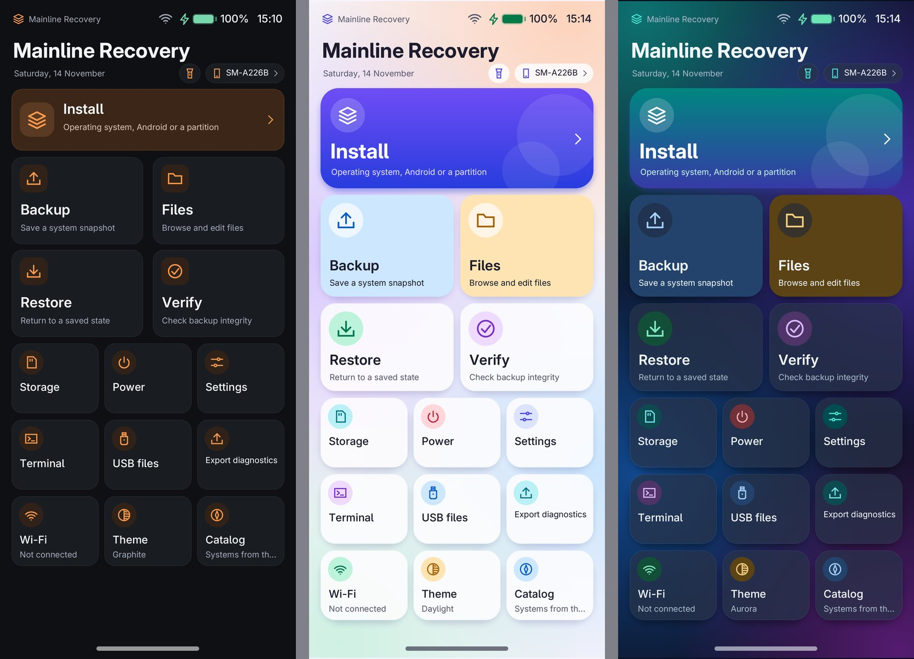
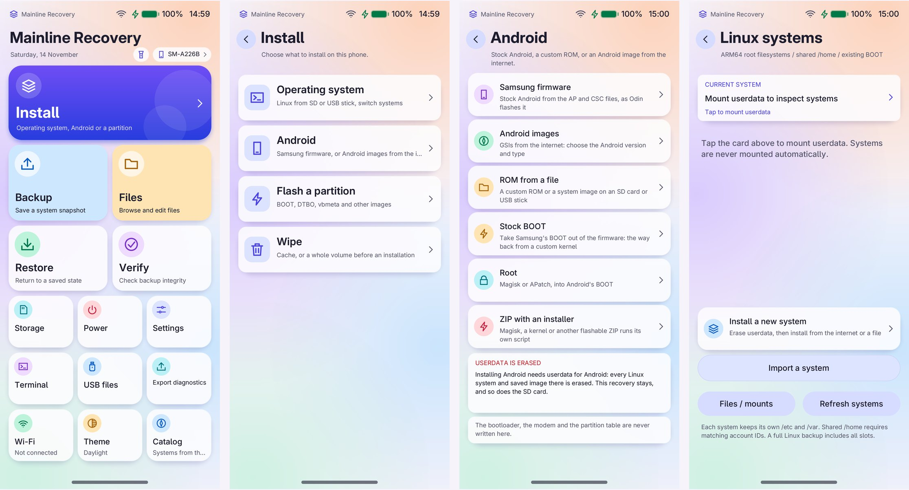
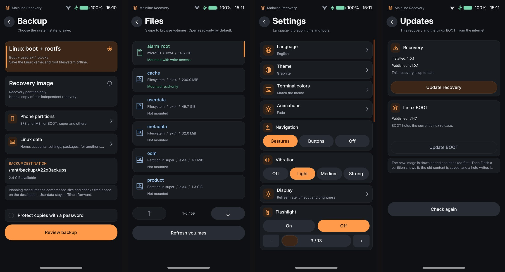
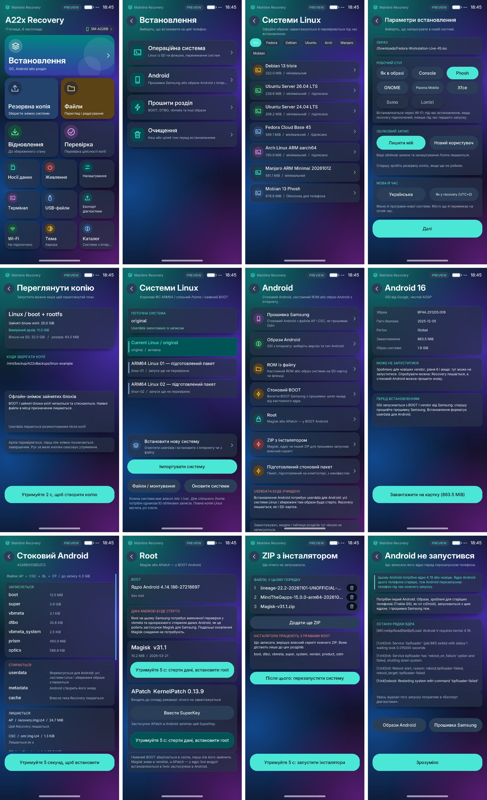
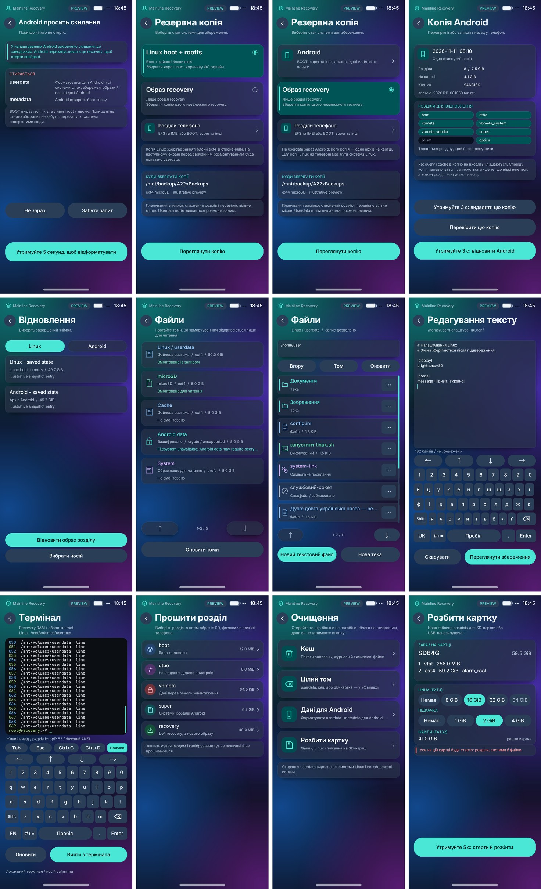
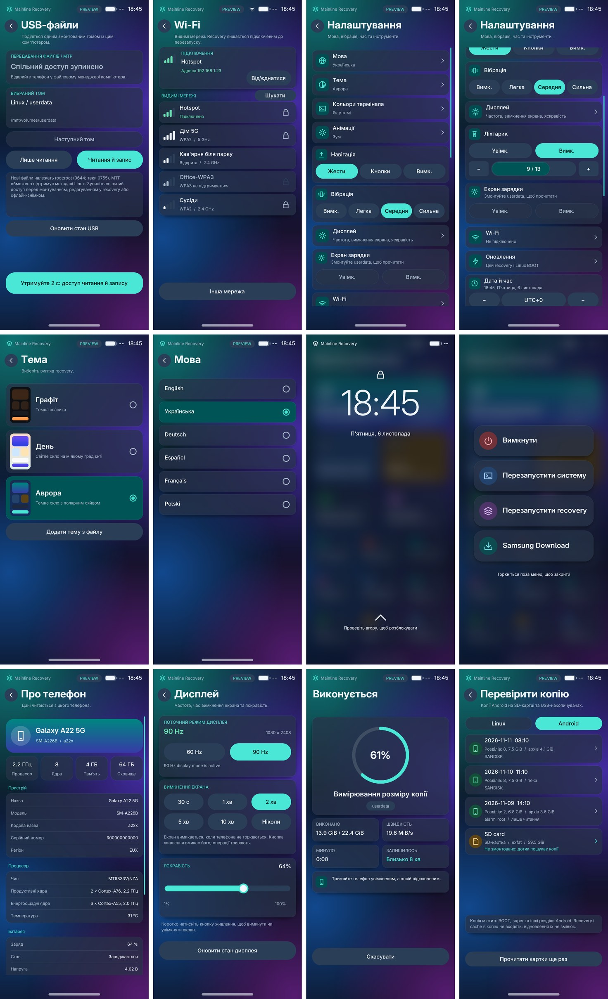

# Mainline Recovery

Власний Linux-recovery для **Samsung Galaxy A22 5G (SM-A226B, MT6833)**. Він стоїть у
розділі RECOVERY (40 МіБ), повністю працює з оперативної пам'яті й має власний
сенсорний інтерфейс. Він встановлює дистрибутиви Linux і керує ними, встановлює
Android (прошивку Samsung, GSI та ROM), прошиває розділи, робить резервні копії й
виконує звичну роботу recovery на зразок TWRP.

English: [README.md](README.md) · Що змінилося в кожній версії:
[CHANGELOG.uk.md](CHANGELOG.uk.md) · Результати тестів: [docs/TEST_RESULTS_UK.md](docs/TEST_RESULTS_UK.md)

| | |
|---|---|
| Завантажити | [Випуски](https://github.com/Dodaskot/mainline-recovery/releases): образ recovery і застосунок-інсталятор |
| Телефон | лише SM-A226B, на 64 ГБ і 128 ГБ (перевірено на телефоні з 64 ГБ). Образи й прошивки перевіряються на те, що зроблені саме для нього |
| Ядро recovery | `7.2.0-a22x-recovery+`, [linux-a22x](https://github.com/Dodaskot/linux-a22x), гілка `a22x-recovery`: ядро телефона (гілка `a22x`), урізане для recovery |
| Linux BOOT | ядро mainline з [a22x-mainline](https://gitlab.com/pessdres/a22x-mainline); recovery сам завантажує його, коли системі потрібно |

## Знімки екрана

Три вбудовані теми — Графіт, День і Аврора (на телефоні, 1.0.1):



Знято на телефоні з 1.0.1 у темі за замовчуванням, Graphite (клавіші знімка, Живлення + Гучність вниз; англійською):




Більше, з демонстраційних даних:





Більше, сторінка за сторінкою: [docs/screenshots/uk](docs/screenshots/uk).

## Можливості

### Системи Linux

- **Встановлення** дистрибутива з вбудованого **каталогу** через Wi-Fi: Debian 13,
  Ubuntu 24.04 і 26.04, Fedora 45, Arch Linux ARM, Manjaro ARM і Mobian 13. Кожен
  образ звіряється з опублікованою контрольною сумою й підписом.
- **З файла** на microSD, USB-накопичувачі чи самому телефоні: rootfs `tar`, образи
  дисків (`.img`, `.img.xz`) і `qcow2`; працюють і образи postmarketOS для інших
  телефонів.
- Для кожного встановлення можна вибрати: оболонки (Phosh, GNOME, Plasma Mobile,
  Xfce, Sxmo, Lomiri), екран входу (автоматичний, текстовий, Phrog, GDM, SDDM,
  LightDM), мову й часовий пояс, обліковий запис, застосунки й пакети, Wi-Fi і
  сценарій налаштування. Оболонки з пакетами встановлює сам recovery; для phoc
  прямо на телефоні збирається виправлення під цей телефон.
- **Кілька систем поруч** на `userdata` зі спільним `/home`: перемикання між ними,
  відкат перемикання, видалення, а також образи, збережені на телефоні, щоб
  встановити їх пізніше без мережі.
- Recovery сам додає кожній системі потрібні модулі ядра, прошивки й служби
  пристрою, і сам ставить потрібний Linux BOOT.
- Один відсоток заряду для recovery і встановлених систем.

### Android

- **Прошивка Samsung** (`AP_….tar.md5` з CSC, BL і CP поруч або весь ZIP прошивки, як
  його завантажено), так, як прошиває Odin, але без ланцюжка завантажувача, модему й
  PIT; потім дані форматуються для Android, як це робить стоковий recovery.
- **GSI та ROM**: з каталогу (GSI від Google, LineageOS, crDroid та інші) або з файла:
  образ system, 7z, блочне OTA, `payload.bin`, ZIP з образами чи ZIP з інсталятором.
- **ZIP з інсталятором** (`update-binary`, edify), один або кілька поспіль, кожен в
  ізольованому середовищі, що бачить лише ті розділи, які ROM для Android може
  змінювати; `adb sideload` працює, як у TWRP. Перевірено на телефоні: LineageOS 20
  для A226B (від Loftenth), ядра AnyKernel3, Magisk; BakaSU (від Kazaf 132) теж запускається. Блочний ROM, чий власний інсталятор упав, recovery
  записує сам, а super розмічається під ROM, чиї розділи не вміщаються.
- Після ZIP, що змінив BOOT Android, recovery пропонує скинути дані Android: на цьому
  Samsung Android зі зміненим BOOT не запускається на старих даних.
- **Root**: Magisk (найновіший випуск, латається на телефоні) або APatch; root
  можна прибрати.
- **Чому Android не запустився**: recovery читає останній журнал ядра, який Android
  залишив у пам'яті, і пояснює його (наприклад, Android, якому потрібне новіше ядро).
- **Скидання до заводських налаштувань**, замовлене в налаштуваннях Android,
  виконується тут.

### Резервні копії та відновлення

- **Копії розділів Android** одним стиснутим архівом (`tar.zst`) на
  картці або USB-накопичувачі, за бажанням разом із зашифрованими даними Android.
  Відновлення спершу перевіряє архів і записує лише те, що відрізняється.
- **Знімки Linux**: BOOT і зайняті блоки `userdata` (partclone, zstd), перевірені до
  того, як позначаються завершеними; відновлення й стирання `userdata` зі знімка на
  будь-якому SM-A226B з тією самою розміткою.
- **Дані Linux**: домашні теки, облікові записи, налаштування (Wi-Fi, Bluetooth, SSH,
  мова) і список пакетів, без самої системи, в один архів. Він відновлюється в інший
  дистрибутив, встановлений тут, або на будь-якому іншому пристрої з Linux скриптом
  `restore.sh` усередині: пакети ставляться під назвами, які має та система.
- **Копії EFS та IMEI** (розділи ідентичності телефона).
- **Під паролем** («Резервна копія» > «Захищати копії паролем»): копії Android, «Дані
  Linux» і архіви з «Файлів» шифруються (AES-256-CTR, PBKDF2-SHA-256, HMAC на весь файл).
  Вони відкриваються на будь-якому комп'ютері через `openssl`, без recovery:

  ```fish
  head -c -56 NAZVA.tar.zst.enc | openssl enc -d -aes-256-ctr -pbkdf2 -iter 600000 -md sha256 | tar --zstd -x
  ```

  Знімки Linux, образ recovery та копії EFS/IMEI зберігаються без пароля.
- Копії можна перевіряти, перейменовувати й видаляти на телефоні.

### Прошивання

- **Прошити розділ**: BOOT, recovery, DTBO, vbmeta, super, prism, optics або окремий
  розділ усередині super (`system`, `vendor`, `product`, `odm`) з образів raw, sparse,
  gzip, LZ4, XZ чи ZSTD, також прямо з ZIP або tar Samsung.
- Образ оцінюється за **вмістом**: образ BOOT чи recovery має бути цілим і називати
  цей телефон; образ для іншого телефона відкидається ще до запису. Завантажувач,
  preloader, LK і модем ніколи не записуються.
- Старий вміст спершу зберігається, а розділ після запису перечитується. Невдалий
  запис одразу повертає збережену копію; запис, обірваний вимкненням живлення,
  доводиться до кінця або скасовується на наступному старті recovery.
- **Оновлення** в налаштуваннях: найновіші опубліковані recovery й Linux BOOT перевіряються,
  завантажуються й записуються так само безпечно.
- Cache прибирається сам: старіші копії recovery й BOOT ідуть; стоковий BOOT, найновіші копії
  й налаштування лишаються.

### Файли й накопичувачі

- Файловий менеджер для кожного тому: `userdata`, microSD, USB-накопичувачі, `cache`
  і розділи Android усередині super (`system`, `vendor`, `product`, `odm`, лише
  читання). Копіювання, перейменування, редагування тексту, права й власник,
  видалення; кілька записів одразу (вибір довгим дотиком).
- **Архіви**: вибрані файли й теки в `tar.zst` (власники, права й посилання
  зберігаються), а будь-який `tar`, `tar.gz`, `tar.xz` чи `tar.zst` розпаковується поруч.
- **USB-файли** (MTP) для комп'ютера; **розмітка картки**; **очищення** cache чи
  тому як ext4 або F2FS; **перевірка й виправлення** ext4, F2FS і FAT; **розширення** ext4.
- Термінал, знімки екрана (Гучність− + Живлення), ліхтарик.

### Мережа й віддалений доступ

- Wi-Fi зі збереженими мережами; завантаження через HTTPS.
- **ADB** (оболонка, push/pull, sideload) і **SSH** з ключами, через USB-кабель
  (USB-мережа `172.16.42.1`).
- Необов'язковий **пароль** блокує recovery, і його питають на телефоні, перш ніж
  комп'ютер отримає оболонку. Якщо налаштування з ним не вдається прочитати,
  recovery лишається заблокованим. Налаштування, пароль і збережені мережі Wi-Fi
  зберігаються двічі, з контрольними сумами, у вільному кінці розділу `misc`, а не на cache
  чи userdata ([SETTINGS_API.md](SETTINGS_API.md)).

### Інтерфейс

- Шість мов: англійська, українська, німецька, французька, польська, іспанська.
- Теми, анімації, 60/90 Гц, яскравість, сила вібрації, час вимкнення екрана, жести або кнопки
  навігації.
- Власні теми й кольори термінала з файла: [docs/MAKING_THEMES_UK.md](docs/MAKING_THEMES_UK.md).

### Застосунок для Android

`apk/` збирає невеликий застосунок-інсталятор (близько 0,4 МБ) для Android з root на цьому
телефоні: він перевіряє телефон, завантажує recovery з його випуску й Linux BOOT з каталогу,
звіряючи кожен із SHA-256, вбудованим у застосунок, встановлює одне або обидва, передає recovery
мережі Wi-Fi, мову й часовий пояс, сам зберігає BOOT Android у cache й сам оновлюється з
найновішого випуску. `apk/build.sh` збирає його без Android SDK.

## Встановлення

1. Розблокуйте завантажувач SM-A226B (це стирає телефон).
2. Прошийте образ із [Випусків](https://github.com/Dodaskot/mainline-recovery/releases)
   у RECOVERY у режимі Download, наприклад через Heimdall:

   ```fish
   heimdall flash --recovery recovery-a22x-1.0.1.img
   ```

   або встановіть його застосунком з Android з root.
3. Запустіть recovery: на вимкненому телефоні з USB-кабелем до комп'ютера
   утримуйте Гучність+ і Живлення; або виберіть **Перезапустити recovery** в меню
   живлення самого recovery.

Новіший recovery потім ставиться із самого recovery: Встановлення → Прошити
розділ → recovery.

## Перевірені на телефоні дистрибутиви

| Дистрибутив | Оболонки | Вхід |
|---|---|---|
| Debian 13 | Phosh, GNOME, Plasma Mobile, Sxmo | Phrog, автоматичний, текстовий |
| Mobian 13 Phosh / Plasma Mobile | Phosh, GNOME, Plasma Mobile, Lomiri, Sxmo | Phrog, SDDM, текстовий |
| Ubuntu 26.04 | Plasma Mobile, Phosh, GNOME, Xfce, Sxmo | SDDM, автоматичний |
| Ubuntu 24.04 | GNOME, Phosh | текстовий |
| Fedora 45 | GNOME, Plasma Mobile, Phosh | GDM, SDDM |
| Arch Linux ARM | Phosh, Plasma Mobile | Phrog |
| Manjaro ARM Phosh / Plasma Mobile | Phosh, Plasma Mobile, Xfce | як в образі, LightDM |
| postmarketOS (образ PinePhone Pro) | як в образі | власний |

## Обмеження

- Розшифрування даних Android поки недоступне, тож файлової копії `/data` немає
  ([стан](docs/ANDROID_CRYPTO_STATUS.md)).
- Перезапуск іноді потрапляє в попередній режим; recovery це помічає й сам
  перезапускається ще раз.
- З під'єднаним комп'ютером телефон не лишається в глибокому сні.
- Plasma зберігає мову в спільному `/home`, тож системи з Plasma мають її спільною.
- Налаштування вже встановленої системи не можна запустити повторно; щоб отримати
  новіші виправлення, встановіть її знову.
- Оновлення, завантажене в «Налаштуваннях», потребує 40 МіБ на cache: коли cache заповнено
  збереженими копіями BOOT, воно зупиняється з CACHE_FULL; спершу видаліть непотрібну копію.
- Якщо живлення зникне під час запису самого розділу recovery, запускати буде нічого:
  прошийте recovery з комп'ютера в режимі Download.

## Збирання

`VERSION=1.0.1 tools/build-image.sh NN` збирає `build-v06-NN/recovery-a22x-mainline-k108-v0.6.img` з
цих джерел, ядра recovery й середовищ виконання поверх кваліфікованого базового
образу та перевіряє, що кожен файл в образі збігається з цим деревом. Прошивки
пристрою й запечатаний профіль платформи знімаються з власного телефона через
`tools/a22x-capture-platform.sh` і ніколи не публікуються.
`PUBLIC=1 PRIVATE=platform-public tools/build-image.sh NN-public` збирає образ для
будь-якого телефона, без ключа SSH і без Bluetooth-адреси телефона.

## Тести

```fish
unshare -r python3 -B -m unittest discover -s tests
cd ui; and make test systems-ui-integration display-ui-integration shells-ui-test locale-ui-test
make -C ui arm64 CROSS_COMPILE=aarch64-linux-gnu-
```

Останній повний прогін, набір за набором: [docs/TEST_RESULTS_UK.md](docs/TEST_RESULTS_UK.md).

## Ліцензія

Новий код — MIT ([LICENSE](LICENSE)); шрифти — за [ui/LICENSE.fonts](ui/LICENSE.fonts).
Зібраний образ містить і окремо ліцензовані компоненти: ядро Linux (GPL), BusyBox,
GNU libc, Python, musl, OpenSSL і прошивки пристрою. Код, назви й графіку OrangeFox
і TWRP не використано.
